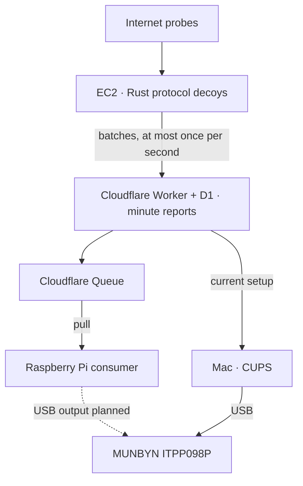

# Honeyprinter

A tiny honeypot with a lot of open ports, turning internet probes into thermal
receipts with port counts, a short Luna summary, and a few sampled exchanges.
The real printer is a **MUNBYN ITPP098P**.

The printer currently runs through a Mac. The Pi consumer works with the queue
and emits receipts to stdout; its physical printer adapter is still pending.

[Printer setup](docs/printer.md) · [Listener setup](docs/listener.md) · [Website and cloud docs](docs/website.md)

## Services

35 endpoints share 24 minimal protocol handlers. The table lists standard ports,
before the development offset. Every endpoint uses TCP; no UDP sockets are opened.

| Service names | Standard ports | Implemented exchange |
| --- | --- | --- |
| `ftp` | 21 | Greeting, USER/PASS rejection, SYST/FEAT/QUIT |
| `ssh` | 22 | Identification banners only; no key exchange or login |
| `telnet` | 23 | Negotiation bytes, login prompt, rejection |
| `smtp`, `submission`, `smtps` | 25, 587, 465 | EHLO/HELO, NOOP/RSET/QUIT; rejects authentication and delivery |
| `http`, `http-alt`, `https`, `https-alt` | 80, 8080, 443, 8443 | One HTTP/1.x request, fixed 404; HEAD has no body |
| `docker`, `elasticsearch` | 2375, 9200 | Generic HTTP decoys on these ports, not Docker/Elasticsearch APIs |
| `pop3`, `pop3s` | 110, 995 | CAPA, USER/PASS rejection, QUIT |
| `imap`, `imaps` | 143, 993 | Tagged CAPABILITY/NOOP/LOGOUT, rejects login |
| `ldap`, `ldaps` | 389, 636 | BER framing and message IDs; bind/search/extended-operation errors |
| `smb` | 445 | SMB2 header recognition and correlated STATUS_NOT_SUPPORTED; no SMB1 |
| `rtsp` | 554 | Request parsing, 401 with CSeq |
| `socks5` | 1080 | Method negotiation, no acceptable authentication method |
| `mssql` | 1433 | Single-packet TDS PRELOGIN response only |
| `mqtt`, `mqtts` | 1883, 8883 | MQTT 3.1/3.1.1/5 CONNECT framing and rejected CONNACK |
| `http-proxy` | 3128 | 407; never opens an upstream connection |
| `mysql` | 3306 | Protocol 10 greeting and authentication error |
| `rdp` | 3389 | TPKT/X.224 connection request and RDP negotiation failure |
| `sip` | 5060 | Request headers and 501 response |
| `postgres` | 5432 | SSL/GSS refusal and protocol 3 startup error |
| `amqp` | 5672 | AMQP 0-9-1 connection.start, followed by connection.close |
| `vnc` | 5900 | RFB version exchange and rejected security negotiation |
| `redis` | 6379 | RESP/inline command parsing, PING/QUIT, NOAUTH |
| `irc` | 6667 | NOTICE greeting and connection rejection |
| `memcached` | 11211 | ASCII VERSION, empty STATS/GET, QUIT; no storage |
| `mongodb` | 27017 | OP_MSG and legacy OP_QUERY hello/isMaster/ping replies; rejects other commands |

TLS endpoints complete actual TLS using rustls, then share the plaintext handler.
STARTTLS upgrades and database TLS upgrades are not implemented. These decoys are
enough for initial protocol interactions; they are not full server emulators and
some clients or scanners will identify their limited behavior.
